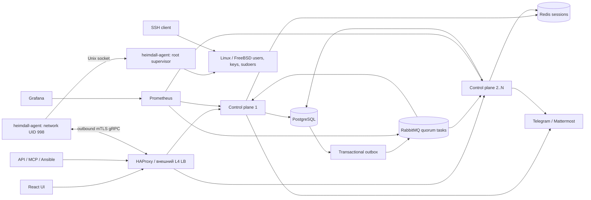

# Архитектура Heimdall

Актуализировано 5 октября 2026 года по реализации в репозитории. Исходные требования находятся в [AGENTS.md](../AGENTS.md). Этот документ описывает реализованное поведение, границы гарантий и оставшиеся эксплуатационные ограничения. Предложения для дальнейшего развития явно обозначены отдельно.

## Требования

| Код | Требование |
| --- | --- |
| R01 | Go backend, React и Material Design 3, PostgreSQL как источник истины, Redis для сессий, Docker Compose для разработки. |
| R02 | Локальные УЗ, одноразовые приглашения, OIDC/LDAP; автоматически назначаемые и редактируемые UID, GID, home, shell, GECOS; Linux-пароль необязателен. |
| R03 | Отдельные этапы регистрации TOTP и passkey. Политики `none`, `any`, `totp`, `passkey`, `both` назначаются администратором пользователю или группе пользователей. |
| R04 | Несколько именованных SSH-ключей, генерация Ed25519, срок действия и политика только security keys. Истёкший/отозванный fingerprint нельзя использовать повторно. |
| R05 | Join-токены, сертификаты и ротация, исходящий gRPC по mTLS, защита от массового переподключения; минимум 20 000 соединений как целевая нагрузка. |
| R06 | Уже применённые Linux-УЗ, ключи и sudo сохраняются при остановке CP, агента и потере сети. Вход и sudo выполняет сама ОС. |
| R07 | Блокировка/удаление удаляет управляемые ключи, Linux-хэш пароля и sudo, блокирует УЗ. Отзыв завершён только после подтверждения всех целей. |
| R08 | RBAC для каталога, нод, sudo, API/MCP, групп хостов и пользователей; сервисные УЗ. |
| R09 | Видимые статусы всех нод, пользователей и операций, зависания и частичное применение; метрики, инциденты, уведомления. |
| R10 | Привязка получателя через «Войти через Telegram», общий бот и доставка разрешённых уведомлений; аналогичная интеграция Mattermost. |
| R11 | API-токены с audience, scopes, группами, сроком и отзывом; актуальная проверка полномочий владельца на каждом запросе. |
| R12 | MCP через общий прикладной слой, Swagger с выключением в YAML и веб-интерфейсе. |
| R13 | Отдельные защищаемые mTLS/basic-auth метрики; YAML-конфигурация, секреты через окружение. |
| R14 | DDD, ограниченные очереди, транзакционный outbox, контролируемая вычислительная сложность. |
| R15 | Динамический Ansible inventory только из доступных владельцу API-токена хостов; TLS-проверка и документация. |
| R16 | Несколько CP за балансировщиком; масштабирование без привязки веб-сессии к экземпляру; возможность отдельного слоя proxy. |
| R17 | RabbitMQ для заданий синхронизации; отказ брокера виден и не теряет желаемые изменения. |
| R18 | Grafana в Compose, воспроизводимые дашборды и реальные метрики каждого CP. |
| R19 | Лаконичный инженерный UI без слоганов; видимые ошибки, работающие RBAC и приглашения; имя страницы в URL. |
| R20 | Дерево групп хостов, наследование ролей и перенос выбранных нод между группами. |
| R21 | Каталог 15–20 тысяч пользователей, страницы и поиск вместо выгрузки всего каталога в браузер. |
| R22 | Наблюдение за управляемыми и посторонними SSH-входами, подозрительными сериями ошибок аутентификации. |
| R23 | Подписанные изменения, проверка подписи root-исполнителем, защита от подмены ноды и rollback, харденинг развёртывания. |
| R24 | Редактируемые продуктовые политики администратора, включая TTL SSH-ключей и сроки обнаружения проблем. |
| R25 | Постоянный набор unit, PostgreSQL integration и Compose acceptance-тестов; воспроизводимые команды и CI. |
| R26 | Heimdall и скандинавский логотип; один протокол для native Linux и FreeBSD. |
| R27 | Раздельные группы людей, UNIX-группы и дерево групп нод. Явное назначение UNIX-группа → группа нод → роль/sudo; отсутствие назначения запрещает native вход. |
| R28 | Уровни и категории допуска дополняют RBAC; требования предков группы нод наследуются. |
| R29 | CRUD ролей и групп; список/имена/отвязка passkeys; управление TOTP и отдельные группы политики факторов. |
| R30 | Join-токен: независимые TTL и количество подключений, включая неограниченное число использований в течение 365d. |
| R31 | Группировка инцидентов, раскрытие конкретного события и закрытие одного/выбранных/всех доступных на странице. |
| R32 | В списках виден статус синхронизации, технические ревизии остаются протоколом; hostname/IP/OS и поиск в карточках нод. |
| R33 | Sudoers: конструктор и текстовые вкладки с предпросмотром, сохранение оригинального синтаксиса. |
| R34 | Уведомление о приближении ротации SSH-ключей; администраторские Markdown-сообщения в обзоре. |
| R35 | Серверная пагинация всех растущих списков; разные команды unit, integration/regression, load. |

## Гарантии и границы доступа

УЗ и группы создаются в локальных системных базах Linux/FreeBSD. Новые установки хранят ключи в `/etc/heimdall/authorized_keys`, sudoers Linux — `/etc/sudoers.d/heimdall_*`, FreeBSD — `/usr/local/etc/sudoers.d/heimdall_*`. При обновлении существующий `/etc/linpam` и префикс sudoers сохраняются. sshd читает файлы непосредственно; нет сетевого `AuthorizedKeysCommand`, PAM callback или запроса к агенту при входе. Linux-пароль хранится отдельно от web-пароля.

Остановка CP, Redis, RabbitMQ, сетевого агента и истечение транспортного сертификата не удаляют доступ. Root-helper хранит последний одобренный манифест, журнал применения, UUID/epoch/revision и раз в минуту исправляет локальный drift. При его остановке уже записанный доступ также сохраняется. Срок SSH-ключа проверяется локальным OpenSSH через `expiry-time`; автономность не продлевает заранее установленный срок.

При блокировке/удалении или утрате последнего разрешения входа root worker очищает управляемые ключи и sudo, заменяет пароль на недействующий хэш, устанавливает nologin и истечение УЗ, завершает сессии и пользовательские процессы до успешного ACK. Home и UID остаются для сохранения данных и предотвращения повторного использования идентичности. Границы атрибуции sudo-процессов описаны в разделе «Завершение процессов при полном отзыве».

**Новый отзыв нельзя доставить изолированной ноде.** До возобновления связи её ранее применённый доступ сохраняется. UI показывает pending, а по установленному сроку создаётся критический инцидент. Эта граница неизбежна при требовании автономного входа; CP никогда не выдаёт неподтверждённый отзыв за завершённый. ACK означает отчёт доверенного исполнителя, без аппаратной аттестации. Компрометированный root может обходить локальные ограничения.

## Компоненты

Control plane — модульный Go-процесс с REST, MCP, gRPC, мониторингом, outbox-worker и уведомлениями. Структура:

| Каталог | Ответственность |
| --- | --- |
| `internal/identity`, `authorization`, `credentials`, `fleet`, `synchronization` | Доменные типы, проверки, правила доступа и протокол состояния |
| `internal/application` | Общий контракт use cases, политики, построение inventory |
| `internal/platform/postgres` | Транзакции, текущий RBAC, каталог, проекции, аудит и outbox |
| `internal/transport/httpapi` | REST, Swagger, MCP, browser authentication и интеграции |
| `internal/synchronization/gateway`, `queue` | Владение stream, delivery/ACK, RabbitMQ |
| `internal/agent/launcher`, `client`, `helper`, `native`, `activity` | Сеть без root, проверка подписей, применение ОС, SSH-телеметрия |
| `internal/platform/pki`, `security`, `metrics`, `config` | PKI, криптография, наблюдаемость и YAML |
| `web/src`, `migrations`, `deployments`, `scripts` | UI, версионированная БД, стенд и воспроизводимые проверки |

REST и MCP вызывают один контракт `application.ControlPlane`; бизнес-правила и транзакционный RBAC находятся в адаптере хранения. Это модульный монолит, а не распределённые сервисы с независимыми каталогами. PostgreSQL скрыт от транспортов интерфейсом.

## Каталог, факторы и RBAC

При регистрации TOTP браузер строит SVG QR-код из полученного `otpauth://` URI локально, без передачи секрета стороннему сервису. Ручной ввод секрета и копирование URI доступны в той же форме. QR-код показывается только для текущей незавершённой регистрации и скрывается после успешного подтверждения.

Web-пароли хэшируются Argon2id, Linux-пароли — SHA-512 crypt. TOTP-секрет зашифрован, recovery-коды и API/join/recovery-токены хранятся как хэши. Приглашение одноразовое и ограничено по времени; токен размещён в URL fragment, а не в query/log запроса. `GET /invite` возвращает SPA, регистрация выполняется `POST /api/v1/auth/invitation`.

Ограниченная сессия допускает регистрацию факторов, но не управление доступом. Все применимые политики человека должны быть выполнены: например, `totp` на УЗ и `passkey` на группе требуют обе регистрации. `any` принимает одну из них. `/me.factor_state` сообщает отдельные состояния и требуемые политики. WebAuthn требует user verification, проверяет origin/RP/challenge и счётчик клонирования; TOTP не принимает повторный timestep. Recovery-коды одноразовые.

Администратор и группы задают обязательный минимум; пользователь вправе зарегистрировать дополнительные факторы независимо друг от друга. Наличие Passkey не запрещает регистрацию TOTP и не выполняет требование `totp`. Личная политика `users.personal_factor_policy` дополняет минимум пересечением, а не заменяет его: `none` означает только отсутствие дополнительных требований. `PUT /api/v1/me/factor-policy` меняет собственную личную политику в собственной браузерной сессии, включая ограниченную регистрацию; API-токены не могут менять эти настройки. При добавлении требования к ещё не зарегистрированному фактору сессия становится ограниченной до завершения регистрации. Снижение личных требований не меняет политики администратора или групп.

Самообслуживание не допускает отвязку, после которой эффективная политика перестанет выполняться. Проверка `mfa_satisfied` выполняется после изменения в той же транзакции; отказ откатывает удаление, `auth_version`, recovery-коды, аудит и задачу синхронизации. При двух Passkey один можно удалить, если остаётся второй; последний обязательный защищён. Сброс чужого фактора администратором с `users.manage` остаётся процедурой восстановления: политика сохраняется, пользователь получает только регистрацию недостающего фактора. `/users/{id}/factors` возвращает минимум администратора, личное требование и разрешения на отвязку; UI показывает причины блокировки, сервер повторно проверяет их при записи.

Эти политики относятся к регистрации web-факторов. На Linux доступны локальный пароль и OpenSSH-ключи; для аппаратного второго фактора SSH используется `sk-*` с `verify-required`. TOTP для PAM Linux в текущий агент не входит. Браузер не может создать SSH `sk`-ключ через WebAuthn: пользователь создаёт его локальным `ssh-keygen -t ed25519-sk` и загружает публичную часть. Генератор UI создаёт обычный Ed25519 и выключается при политике только SK.

`users.kind=service` даёт активную техническую УЗ без интерактивной web-аутентификации, приглашения и обязательного web-MFA. Роли, нативные параметры и SSH-ключи применяются по тем же правилам. Администратор с `users.manage` и `tokens.manage` может выпустить токен на активную сервисную УЗ; права ограничиваются текущими полномочиями и администратора, и владельца. Блокировка владельца немедленно запрещает новый API/MCP-запрос.

Прямые и групповые назначения объединяются в `effective_role_bindings`. Группы хостов — дерево с closure-таблицей, глубина ограничена 32, циклы запрещены. Назначение на родительскую группу распространяется на потомков. Closure пересчитывается при редком редактировании дерева, а не на каждый запрос. Права токена на группы — точные UUID или `*`, уже ограниченные текущим RBAC владельца. UI показывает дерево и форму переноса до 500 нод с проверкой прав на источник и назначение.

Principal собирает индекс прав; проверка отдельного permission выполняется через map. Транзакция изменения повторно проверяет principal, чтобы отзыв роли между чтением формы и сохранением не был проигнорирован. Linux-доступ отделён от разрешений управления каталогом. Роли, sudo и scope никогда не назначаются пользователем себе через профиль.

## Синхронизация

1. В одной транзакции PostgreSQL изменение блокирует текущую системную revision, проверяет актуальный RBAC, записывает данные, аудит, операцию, целевые ноды и outbox. Ошибка откатывает всё.
2. Outbox-worker выбирает до 32 записей через `FOR UPDATE SKIP LOCKED`, публикует persistent tasks в quorum-очередь `heimdall.sync.tasks` и отмечает публикацию после publisher confirm.
3. Конкурирующие consumers публикуют wakeup в fanout exchange. Каждый CP получает событие своей временной очередью, объединяет серию сигналов и будит собственные pending streams. Подтверждение RabbitMQ означает только обработку сигнала.
4. CP рассчитывает full/delta projection в согласованном snapshot PostgreSQL, подписывает точные JSON bytes Ed25519 и передаёт payload/signature/SHA-256 digest.
5. Root-helper проверяет подпись доверенным локальным ключом, digest, schema, NodeID, epoch/revision/base_revision и нативные параметры. При первом применении дополнительно проверяет сохранённые root nonce и хэш join-токена. Подписанное состояние чужой первоначальной регистрации отклоняется, даже если подписант тот же.
6. Helper журналирует намерение, применяет Linux-изменения, атомарно пишет файлы с fsync и возвращает результаты по ресурсам. Полностью успешное состояние становится checkpoint.
7. CP сверяет ACK с отправленным digest, revision, набором ресурсов и generation текущего stream. Только такой ACK продвигает applied_revision и цели операций.

Повторная публикация/доставка безопасна: важна монотонная revision, а не число обработанных заданий. Потерянный ACK восстанавливается full snapshot, если root-checkpoint новее отметки CP. Повтор той же неуспешной revision действительно применяется снова. Отказ очереди сохраняет outbox; резервный опрос БД каждые 5 секунд продолжает доставку и одновременно показывает недоступность брокера.

Локальный `desired.json` содержит полный материализованный набор для автономного исправления drift. При delta обновляются только переданные УЗ; определения UNIX-групп остальных УЗ сохраняются. Замена идентичности именованной группы в delta запрещена. Полный snapshot заменяет определения групп, а объединённый журнал повторно проходит проверку membership и меток перед атомарной записью.

Пустой сетевой ответ или ошибка каталога не являются командой удалить все УЗ. Только проверенный, подписанный full snapshot может описывать полный набор. Отзыв очищает права раньше выдачи новых. Некорректный sudoers блокирует выдачу повышенных прав, но не мешает очистить отзываемые права. `visudo` проверяет объединённый изменённый набор один раз за применение; неизменённые sudo-файлы не перезаписываются.

Манифест ограничен 20 000 УЗ на ноду и 16 MiB payload; транспорт/helper имеют дополнительные ограничения для base64 JSON. Превышение возвращает видимую ошибку и сохраняет предыдущее состояние. Root-only журнал отделён от транспортной identity агента. UID/GID >= 10000, home — чистый прямой путь в `/home`, shell ограничен списком, root/зарезервированные идентичности и symlink в управляемых путях запрещены.

## Подключения и масштабирование

Агент инициирует TLS и gRPC; серверная нода не принимает административный порт агента. Сертификат привязан к UUID, текущему serial и сроку в PostgreSQL. Срок сертификатов нод редактируется в админке: по умолчанию 10 лет (3650 дней), диапазон 1–3650 дней. Штатная ротация распределена по стабильному UUID в окне 7–8 часов до истечения; heartbeat дополнительно проверяет wall clock после suspend/коррекции времени. После истечения транспорт восстанавливается одноразовым десятиминутным токеном, привязанным к UUID; локальные УЗ и identity ноды сохраняются.

Изменение TTL увеличивает отдельную `certificate_policy_version` и ставит подписанный манифест всем управляемым нодам. Агент фиксирует запрос перевыпуска, запрашивает новый сертификат собственным ключом и переподключается. В БД отдельно хранятся выданная и подтверждённая версии: сертификат считается установленным только после нового mTLS-подключения с его serial, а не после ответа Renew или UNIX ACK. Offline-ноды остаются в `certificates_pending`; окончание операции проверяется отдельно от native targets. Если TTL снова изменился во время выпуска, запись устаревшей версии отклоняется.

Предыдущий ещё действительный serial допускается для ограниченного восстановления потерянного ответа: максимум 15 минут, не позднее старого NotAfter. Повторная попытка не продлевает это окно, история serial не накапливается, явный recovery удаляет прежние credentials. Истёкшие сертификаты не принимаются. PKI init обновляет публичные CA/server сертификаты существующими ключами: CA на 20 лет, server на 10 лет. Агент получает обновлённый публичный CA через TLS Renew, принимает только ту же SPKI/Subject, сохраняет в network state и проверяет сертификат ноды, ключ и chain до замены. Смена ключа CA требует отдельного доверенного provisioning; state signing key не меняется.

Случайная задержка и exponential backoff, paced accept, ограниченное число handshake/строителей snapshot и coalesced wakeups ограничивают нагрузку возвращающихся агентов. Обновление generation в БД ограждает старый CP от применения ACK после переподключения к новой реплике. CP пакетирует heartbeat и проверку серийных номеров.

Compose запускает два CP и HAProxy в TCP pass-through с `leastconn`; TLS/mTLS завершается на CP. Docker DNS обнаруживает реплики. `docker compose up -d --scale controlplane=N` масштабирует до 16 слотов текущего `server-template`; для большего N изменяется шаблон LB. Уже открытый stream не перемещается сам по себе. Отказ CP заставляет его агентов переподключиться с jitter. Web-сессии общие через Redis.

Каждый CP: 32 соединения PostgreSQL, `nofile=131072`, лимит памяти 1536 MiB и `GOMEMLIMIT=1GiB`. Бюджет БД, RAM, TLS handshakes и snapshot workers учитывается для общего N; число реплик не отменяет лимит PostgreSQL. В production LB также должен иметь несколько экземпляров. Отдельные TCP proxy могут масштабироваться независимо без доступа к ключам подписи или каталогу.

Каталог проверен на 20 000 пользователей: cursor pagination до 500 записей, индексированный literal-prefix поиск, пакетное чтение ролей/ключей, индекс пользователей по kind. Это отдельный сценарий от 20 000 сетевых агентов. Предыдущий нагрузочный прогон одного CP подтвердил 20 000 одновременных mTLS streams; он не доказывает native provisioning 20 000 УЗ на одном хосте и не заменяет новый HA capacity test.

## Наблюдаемость и подозрительные входы

UI отдельно показывает connectivity, desired/applied revision, ошибку и last_seen. Есть агрегат флота, страницы нод/пользователей, user sync по нодам, операции и их цели, инциденты и аудит. Принятое изменение не отображается как уже применённое. История API обычно ограничена последними 200 событиями, большие списки имеют cursor. Action-error не скрывается за modal и не очищается успешным фоновым polling. React error boundary показывает ошибку и перезагрузку вместо пустой страницы.

Prometheus обнаруживает каждую реплику через DNS и собирает отдельные process/Go/agent connection показатели. Глобальные SQL gauges в Grafana агрегируются `max`, чтобы не умножать число нод на количество CP. 20 provisioned panels содержат pending/revocation age, перевыпуск сертификатов, фазы нод, соединения, память/CPU/goroutines, очередь, outbox, доставку уведомлений, инциденты и LDAP status. Изменять исходный дашборд нужно через `scripts/generate-dashboards.py` / `make dashboards`; provisioning может перезаписать UI-правки Grafana.

Метрики включают `heimdall_agent_connections`, `heimdall_nodes_connectivity{state}`, `heimdall_nodes{phase}`, `heimdall_sync_pending_nodes`, `heimdall_sync_oldest_pending_seconds`, `heimdall_revocation_pending_nodes`, `heimdall_outbox_oldest_pending_seconds`, `heimdall_queue_connected`, `heimdall_notification_oldest_pending_seconds`, `heimdall_sync_detector_timestamp_seconds`, `heimdall_metrics_snapshot_timestamp_seconds`, `heimdall_directory_failed`, `heimdall_directory_last_success_timestamp_seconds`. Labels не содержат login, fingerprint и UUID пользователя. Метрики CP доступны только с basic auth в Compose; YAML включает TLS/mTLS и отдельную client CA для production.

SQL detector использует редактируемые сроки offline/stalled/revocation. Внешние Prometheus rules независимо обнаруживают отказ CP, зависший detector, устаревшие метрики, очередь, outbox и уведомления. Пороговые Prometheus rules в Compose заданы в `deployments/alerts.yml`; сроки stalled/revocation берутся из runtime gauges и меняются вместе с Settings. Остальные SLO внешних подсистем задаются в rules.

Root-helper читает OpenSSH auth log (параметр `-auth-log`), распознаёт successful managed/unmanaged login, root-login и серию >=5 failed authentication с одного адреса за минуту. Ротация/усечение файла учитывается, читается ограниченный объём, события сохраняются в root spool (максимум 10 000) и отправляются пачками до 100 по mTLS. ACK удаляет их только после коммита PostgreSQL. Переполнение/зависший spool видны в health и инциденте применения. `/security/events` проверяет scope `security.read`.

Это конкретная SSH-телеметрия, а не полноценный EDR: процессы, содержимое команд, sudo-сеансы и journald без файла сейчас не анализируются. Политика хранения security_events/audit и экспорт в SIEM задаются эксплуатационно; автоматическая partition/retention ещё не реализована. Security-инцидент не исчезает автоматически после устранения ошибок синхронизации. После расследования пользователь с `incidents.manage` закрывает его с записью в аудите; sync-инциденты закрываются только detector после восстановления. Отключение управления нодой не очищает её native доступ: недоставленные изменения продолжают показываться pending. Для вывода хоста из эксплуатации сначала отзывают доступ и получают native ACK.

## API, inventory, MCP и интеграции

Ansible: `GET /api/v1/ansible/inventory` требует API Bearer token, permission `inventory.read` и действительную Linux-роль владельца на хост. Offline хосты остаются в inventory, disabled ноды и заблокированные владельцы исключаются. Полное описание TLS, script inventory, service token и групп: [Ansible](ansible.md).

MCP использует официальный Go SDK, stateless Streamable HTTP на `/mcp`; cookie и join-токен не дают MCP-доступ. Audience `mcp` обязательна. Доступны list_nodes, list_users, list_incidents, list_operations, user_sync_status, retry_node_sync, disable_user; scopes проверяются общим слоем. Обнаружение OAuth MCP и выдача OAuth access tokens этим сервером не реализованы; используется ручной Bearer token.

Swagger/OpenAPI требуют `api_docs.read`. YAML `swagger.enabled: false` или `mcp.enabled: false` жёстко закрывает endpoint; runtime flag в Settings может выключить разрешённую YAML функцию. Swagger assets локальные, без CDN. OpenAPI публикует текущие основные маршруты и параметры страниц.

OIDC использует discovery, PKCE/state/nonce и стабильную пару issuer/subject; привязка к существующему пользователю требует административного решения. LDAP синхронизирует внешний каталог по стабильному ID, хранит source и отдельный last-success/phase; неполная/неожиданно пустая выгрузка не выполняет массовый отзыв. UID и права не выдаются произвольно по email/username провайдера.

Telegram связывается подтверждённым OAuth/OIDC subject с УЗ Heimdall. Общий бот доставляет частные сообщения разрешённым получателям. Mattermost связывает пользователя OAuth и использует DM. Подписанный/защищённый callback, state/nonce, повторная проверка RBAC перед отправкой и durable notification_jobs с retry/lease препятствуют подмене получателя и потере сообщения. Уведомления не заменяют независимый Prometheus/Alertmanager.

Для этих интеграций нужны реальные credentials, разрешённые callback URL и доступ к провайдеру. В Compose они выключены. Проверены внутренние проверки и SQL-поведение, но отправка в реальные Telegram/Mattermost и аппаратный passkey не подтверждены локальным acceptance-прогоном.

## Конфигурация и харденинг

`config/controlplane.yaml` содержит адреса, TLS, transport, providers и имена env variables. `.env` локального стенда содержит пароли PostgreSQL/Redis/Rabbit/Grafana, ключ шифрования, join token и первоначальный admin password. Секреты не выводятся в API и не сохраняются в frontend. Публичный CA и signing public key передаются на ноды из доверенного provisioning; private PKI доступна только CP/init.

Веб Settings редактирует TTL ключей, требование SK, сроки stalled/offline/revocation и runtime Swagger/MCP. В БД есть optimistic version; устаревшая форма не перезаписывает новое значение. Уменьшение TTL сокращает срок существующих активных ключей; увеличение не продлевает их срок. Новые ключи повторно проверяют актуальную политику внутри транзакции.

Сроки в UI принимают `s/m/h/d`, например `7d` или `30s`, с проверкой диапазонов. При настройке join-токена лимит использований и срок независимы: изменение лимита сохраняет дату истечения; продление включается отдельным выбором и отсчитывается от сохранения. Список токенов имеет поиск по ID/группе и получает название группы в своей странице, без зависимости от первых 100 групп каталога.

Адреса БД, listener, TLS/private keys и секреты providers остаются deployment-конфигурацией с перезапуском CP, чтобы изменение через браузер не превращалось в обход границ доверия. Все продуктовые параметры текущей `Settings` доступны UI; произвольное редактирование infrastructure YAML и секретов через UI не реализовано.

CP-контейнер запускается без root, с read-only FS, без capabilities, с no-new-privileges и tmpfs. Agent работает под UID 998; root-helper имеет только локальный Unix socket с проверкой peer credentials и не открывает сетевой listener. На новой ноде root сохраняет nonce/хэш выбранного join-токена до сетевого обмена, затем навсегда закрепляет UUID/epoch. Правки разрешены только доверенным signer и монотонным протоколом. Старые уже enrolled ноды используют существующий root checkpoint.

Production deployment требует:

- TLS для browser/API (`development:false`, Secure cookie), TLS/mTLS и ACL для PostgreSQL/Redis/RabbitMQ; management/metrics не публиковать в пользовательскую сеть.
- Минимум 3 RabbitMQ quorum members, HA PostgreSQL с PITR/проверкой восстановления, HA Redis и несколько LB; Compose демонстрирует механику, но сам запускает одиночные хранилища/LB.
- Root-owned trust/checkpoint, отдельный непривилегированный agent, защищённые systemd units, отсутствие shell у service processes, firewall и OS updates. CP не требует `privileged` или Docker socket. Helper требует реальных операций passwd/sudo и не должен иметь доступ к private CA.
- PKI/шифрование secrets из secret manager, отдельное управление ротацией signing/CA и резервными копиями, break-glass локальная УЗ вне управляемого диапазона, журнал восстановления и регулярные упражнения по отказу.
- Согласованные часы, auth log rotation, лимиты дисков/spool, экспорт audit/security events и retention; мониторинг самой системы оповещений.

KMS/HSM, автоматическая смена CA/signing trust bundle с overlap, Linux PAM TOTP, запись SSH-сеансов, принудительное завершение активных сеансов и аппаратная аттестация — отдельные расширения, текущая реализация их не обещает.

## Архитектурное ревью

| Узкое место / риск | Реализованное решение | Ограничение / дальнейшая работа |
| --- | --- | --- |
| Отзыв при offline | Durable targets, критический pending, native ACK | Нельзя одновременно гарантировать автономный вход и мгновенный сетевой отзыв на изолированной ноде |
| Сбой между коммитом и очередью | Transactional outbox, publisher confirms, повторная доставка, polling | RabbitMQ production требует quorum и capacity для накопления |
| Массовое восстановление | Jitter/backoff, admission, пакеты heartbeat, bounded builders, leastconn | Полный HA test на 20k после изменения архитектуры нужен на отдельном стенде |
| Глобальная revision | Короткая сериализованная запись и согласованный snapshot | Интенсивные массовые writes упрутся в revision-row; следующий шаг — partition revisions по fleet/shard после измерения |
| Изменение всей политики | Одно обновление целей, объединение wakeups, delta для изменений УЗ | Full fanout всё ещё O(nodes × affected accounts); нужны пределы fanout и отдельные SLO |
| 20k пользователей | Индексы, keyset страницы, пакетная projection, 20k regression fixture | Первичное создание 20k native УЗ на одном хосте через useradd/usermod не измерено; ОС переписывает passwd/shadow, массовый batching требует отдельной реализации |
| Смена CP владельца | DB generation fencing, текущий serial, общие Redis sessions | Текущий stream распределяется только при подключении, нужен graceful drain для перераспределения |
| Авторизация и токены | Current RBAC на запрос и повторная проверка в mutate TX | Увеличение CP требует общего бюджета PG pools; нет автономного кеша ролей, который переживает отзыв |
| Sudo drift/validation | Один visudo на изменённый набор; symlink rejection; revoke очищает права | Сторонний root и внешние sudoers остаются частью доверенной ОС |
| Повтор/подмена manifest | Ed25519, strict JSON/digest, root nonce/token intent, UUID/epoch/revision | Компрометация CP signer даёт право подписывать доступ; нужен отдельный signer/HSM для более сильной модели |
| Restore PostgreSQL из старого backup | Root epoch/revision не разрешают тихий rollback | Оператору нужен согласованный recovery protocol; нельзя стирать root checkpoint для удобства |
| LDAP на нескольких CP | Идемпотентные стабильные ID и транзакции, статус/ошибки | Каждая реплика пока выполняет sync; отдельный leased directory worker уменьшит повторные чтения |
| Наблюдаемость | Независимые alerts + UI/status + durable notifications | Надо доставлять Alertmanager alerts во внешний независимый канал, поскольку CP bot также зависит от CP |
| Телеметрия и история | Ограниченный root spool, dedup, RBAC event API | Partition/retention и SIEM нужны до большого production-потока |
| HA демонстрации | Две CP, DNS LB, общие данные, тест single-instance failure | Единственный LB/PG/Redis/Rabbit Compose не является production HA |

Код Teleport использовался как ориентир для сравнения PKI, туннелей и разделения transport/authentication. Heimdall сохраняет собственную модель native Linux доступа и не переносит online login dependency из другой системы. [Исходный проект](https://github.com/gravitational/teleport).

RabbitMQ publisher confirm и consumer ACK подтверждают разные этапы доставки; ни один не является подтверждением изменения Linux. [Документация RabbitMQ](https://www.rabbitmq.com/docs/confirms). Дашборд воспроизводится provisioning, редактируется его исходник. [Документация Grafana](https://grafana.com/docs/grafana/latest/administration/provisioning/).

Проверки гарантий, команды и отчёты находятся в [testing.md](testing.md). Развитие архитектуры следует начинать с измеренного bottleneck и нового regression-сценария, сохраняя автономность и честный статус отзыва.

## FreeBSD и переименование

Native executor разделён на общую проверку/journal/reconciliation и адаптеры Linux (`useradd/usermod/shadow`) и FreeBSD (`pw/master.passwd`). POSIX параметры, подписанный протокол, root intent, ACK, RBAC, PKI и telemetry общие. FreeBSD peer identity проверяется `LOCAL_PEERCRED`, службы поставляются как rc.d с независимым жизненным циклом SSH; пароль передаётся `pw -H 0` через stdin. Миграция UID/GID/login/home требует предварительного подтверждённого disablement и допускает восстановление прерванного переноса home. [Установка и регрессия FreeBSD](freebsd.md).

Название продукта, UI, API docs, бинарники, метрики и дашборд — Heimdall. Сохраняются технические имена Compose project/volumes/DB и gRPC `linpam.agent.v1`, чтобы обновление не создавало пустой стенд и не отрезало старые агенты. Существующие cookies и root-owned legacy native каталоги сохраняются. `.env` обновляется без смены значений, новый CSRF header поддерживается вместе со старым. Это совместимость сохранённых данных, не второе название продукта.

Тестирование разделено на независимые уровни: unit без внешних зависимостей, функциональная integration/regression и отдельная нагрузка с собственной БД/генератором. `test-all` не включает нагрузку. [Команды, отчёты и ограничения](testing.md).

Отключение ноды от CP блокирует её transport identity и исключает из inventory, сохраняя native доступ. Оно не выдаётся за отзыв локальных УЗ. Смена только transport-флага не создаёт фиктивного native pending/ACK; ранее неподтверждённые изменения остаются видимыми. Для отзыва блокируется пользователь и ожидается настоящий ACK.

## Результаты capacity-проверки и узкие места

Две CP и отдельный proxy распределили 20 000 mTLS/gRPC streams поровну. Broad update получил 20 000 ACK за 6,22 секунды без failed attempts; отдельная projection каталога 20k занимает около 0,93 секунды и 8,07 МБ. Метрики основного приложения и isolated load разделены по Prometheus job/дашбордам. [Условия и отчёты](testing.md).

HAProxy при 20k занимает около 246 МБ: memory budget proxy должен иметь запас, поэтому нагрузочный лимит установлен 512 МБ. CP использовали около 0,9 ГБ каждая. Новый primary bottleneck для массовых изменений — CPU/БД/fanout, особенно full snapshots при широкой смене ролей. Эти измерения не означают доставку 20k пользователей на каждую из 20k нод: такой квадратный worst case нужно моделировать отдельно. Обычные user changes используют delta, уведомления коалесцируются; admission, bounded workers, reconnect jitter и PostgreSQL как источник истины защищают CP от неконтролируемой лавины.

UI использует literal substring search по логину/имени, hostname/IP/названию и keyset pages. Поиск экранирует `%`, `_`, `\`, не превращая ввод инженера в SQL LIKE-pattern. Участники групп изменяются инкрементально пачками до 500 UUID; отсутствующие на странице участники сохраняются. Autocomplete подгружает серверные страницы по 100 записей, не сравнивает 20k выбранных значений с 20k options.

## Каталоги и модель доступа

`users` хранит идентичность Heimdall, POSIX-профиль и тип human/service; web- и native-пароли независимы. `user_groups` объединяет людей для административного RBAC, политики факторов и SK. `unix_groups` задаёт системное имя/GID и дополнительные memberships; primary membership определяется GID профиля. `server_groups` — отдельное дерево хостов. Одинаковые названия разных каталогов не связывают их автоматически.

`unix_group_role_bindings` назначает UNIX-группу на группу нод через роль. Наследование группы нод применяется явно через closure. View `native_role_bindings` объединяет native назначения, а `effective_role_bindings` отвечает за CP/API. Административные permissions роли, использованной в UNIX-назначении, **не передаются** пользователю Heimdall. Без подходящего native назначения УЗ не получает вход. Отзыв группы пересчитывает ключи/пароль/sudo и supplementary groups, ожидает ACK и отражается в синхронизации.

Schema 2 подписанного snapshot содержит именованные UNIX-группы и метки допуска. Helper сначала создаёт нужные группы, проверяет коллизии имени/GID и принадлежность управляемому каталогу, затем применяет пользователей и memberships. Legacy schema 1 читается для совместимости. Agent старой версии не должен ACK неподдерживаемую schema: обновление исполнителя — условие доставки новой модели.

Идентичность существующей UNIX-группы (имя/GID) не переименовывается незаметно. Для изменения требуется снять назначения/primary references и заменить группу; POSIX-профиль пользователя изменяется в режиме обслуживания после подтверждённой блокировки. Неуправляемые группы ОС не перезаписываются. Пустая системная группа может оставаться после отзыва — это не grant доступа.

Группы политики факторов: «Факторы: опционально», «Факторы: TOTP», «Факторы: Passkey», «Факторы: TOTP + Passkey». Перемещение между cohort-группами удаляет предыдущее cohort-членство; политики обычных групп и конкретного пользователя продолжают пересекаться. Менеджер людей не может через membership назначить административную роль без `roles.manage` и соответствующих permissions/sudo для её области. Удаление/перенос не оставляет систему без действующего global admin. Service accounts не регистрируют человеческие факторы и используют API-токены с актуальными RBAC/scopes.

Мандатный допуск — уровни Public/Internal/Confidential/Secret и до 64 категорий, сравнение dominance на CP и независимо в helper. Это ограничение допуска к хосту; установка SELinux/FreeBSD MAC-политики для процессов не входит в текущую реализацию.

## Пользовательские сценарии и страницы

Навигация использует `?page=...`, в том числе `people-groups` и `unix`; Back/Forward сохраняют страницу. Формы создания/настройки/удаления открываются отдельно. Группы хостов показаны компактным раскрывающимся деревом с реальным direct count, выбранная группа фильтрует ноды. Перенос — выбор хостов и целевой группы. Карточка ноды показывает сообщённые hostname/IP/OS, время метаданных и редактируемый адрес Ansible SSH; metadata не является доверенной авторизацией.

Демо включает UNIX-группы `demo_operators` и `demo_automation`, явные native назначения, группу людей Demo engineers и сервисную УЗ `demo_ansible` с отдельной ролью `inventory.read`. Сервисная УЗ не получает sudo и не имеет выданного токена/SSH-пароля автоматически. Демо содержит четыре независимых persistent Linux-ноды: `linux-demo`, `linux-stage`, `linux-web`, `linux-db`; группы Staging и Production находятся под Demo Linux. HTTP/API и исходящие gRPC streams обслуживают две CP за leastconn proxy. Сторонний alfa-cluster не запускается скриптами Heimdall.

Роль хранит оригинальные sudoers User_Spec справа от логина. Конструктор задаёт Host_List, Runas, команду/аргументы и PASSWD/NOPASSWD, показывает нативный результат. Пустые аргументы рендерятся как `""`, запрещая аргументы; `*` вводится явно. Сложные tags, wildcards и списки остаются в текстовом редакторе без потери данных. Helper добавляет доверенный UNIX-login и проверяет весь файл `visudo` до установки. Глобальные Defaults/include не принимаются как правило отдельной УЗ: они меняли бы права других пользователей.

Инциденты агрегируются по типу и ноде, повторы одного login/address на ноде сливаются в пятиминутном окне с occurrence count/first/last timestamps. Raw security events сохраняются отдельно. В раскрытой группе каждый инцидент имеет своё краткое сообщение, детали и выбор. Bulk close транзакционно проверяет все UUID и права; ошибочная/чужая цель откатывает пачку. Sync/revocation incident закрывается только подтверждённым восстановлением, вручную можно подтвердить ознакомление. Закрытие группы в UI относится к текущей серверной странице.

Растущие коллекции users/nodes/groups/people/UNIX/roles/keys/bindings/tokens/join-tokens/operations/targets/audit/security events/incidents/announcements имеют серверный `limit` (100 default, 500 max), `after` и header `X-Heimdall-Next-Cursor`. Cursor привязан к стабильному порядку `(sort field, UUID)`, audit — numeric id; `after` непрозрачен клиенту. Сначала применяется RBAC и фильтр, затем limit и projection. При изменении фильтра клиент начинает с первой страницы. Протокол keyset не обещает immutable snapshot истории при параллельных новых writes. Passkeys ограничены 100 на УЗ, UI показывает страницы по 10; notification channels ограничены двумя провайдерами.

Пассивные страницы не опрашивают невидимые списки. UI получает только текущую страницу каждые 5 секунд; локальная форма не затирается фоновым polling. Ошибки HTTP/render видны в Alert, в том числе внутри Dialog. Внешний Markdown в баннерах не исполняет HTML, не загружает картинки/скрипты и ограничивает URL. Предупреждения о скором истечении SSH-ключа привязаны к владельцу и configurable `key_warn_seconds`.

API/MCP используют тот же прикладной RBAC. MCP list-tools принимают limit/cursor/query и возвращают items/next_cursor. Swagger перечисляет новые CRUD/factor/UNIX endpoints, пагинацию и batch close; доступен только при разрешённой конфигурации и `api_docs.read`.

За основу поведения поиска и списков взяты [Teleport Web UI](https://goteleport.com/docs/connect-your-client/teleport-clients/web-ui/) и [RFD server-side pagination/filtering](https://github.com/gravitational/teleport/blob/master/rfd/0055-webui-ss-paginate-filter.md). Модель локального автономного SSH остаётся требованием Heimdall.

Последние UI/каталог изменения ещё не прошли полный regression/load прогон: пользователь попросил сначала зафиксировать UX. Предыдущие capacity-измерения выше относятся к предыдущей версии модели; они не подтверждают производительность всех новых сценариев.

### Каталог доступных нод и подтверждения изменений

Обычный пользователь открывает каталог собственного доступа: поиск по имени, hostname, IP-адресу, SSH-адресу и группе; страницы до 100 нод; UNIX-логин, SSH-команда и эффективные роли/sudo в раскрываемой карточке. `GET /api/v1/me/nodes?query=...&limit=100&after=...` использует идентификатор текущей браузерной сессии и `native_role_bindings`, включая назначения UNIX-групп и наследование групп нод. Проверяются активность пользователя, зарегистрированные обязательные факторы, shell, блокировка ноды и мандатные метки. Фильтрация предшествует LIMIT; курсор возвращается в `X-Heimdall-Next-Cursor`. Для просмотра этого же списка в карточке другого пользователя администратором есть `/users/{id}/nodes` с обязательным глобальным `users.manage`; обычный пользователь не может менять владельца запроса. Список не требует `nodes.read`: это право просмотра инфраструктуры оператором, а не право SSH-входа. API-токены используют отдельный `/ansible/inventory` с проверкой scopes и владельца.

Синхронизация видна только с `sync.read`; статистика инфраструктуры — с `nodes.read`, инциденты — с `incidents.read`, включая назначения на конкретную группу. У обычных пользователей эти блоки и запросы отсутствуют. Плашки control plane и кнопки обновления нет. Web загружает данные при навигации, поиске, смене страницы и после принятого изменения; периодического опроса API нет. Ошибки фактически выполненного запроса остаются видимыми. При отсутствии связи данные сохраняются, но их актуальность без нового запроса не утверждается. Метрики, наблюдение за агентами и доставка уведомлений работают на backend независимо от открытого браузера.

Изменение факторов, обязательных политик, профилей, членства, RBAC/MAC, UNIX-паролей, отзыв ключей, выпуск/отзыв токенов, восстановление сертификата, перенос или отключение нод требуют отдельного Material 3 окна с последствиями до отправки запроса. Отмена не отправляет запрос и не отображает ошибку. Объект запроса фиксируется перед подтверждением; значения паролей, TOTP и токенов не попадают в текст окна. Существующие окна удаления остаются единственным подтверждением. Это гарантия пользовательского интерфейса, а не механизм авторизации API: сервер повторно проверяет RBAC, последнего администратора и допустимость отвязки обязательных факторов. При подтверждённом сохранении собственного профиля браузерная сессия обновляется; другие сессии завершаются через `auth_version`, а новые обязательные требования ограничивают доступ до регистрации.

## Уточнение модели доступа и UX (05.10.2026)

Основной путь назначения: **UNIX-группа → группа нод → роль**. Группа людей отвечает за Heimdall permissions и минимальную политику факторов; системная UNIX-группа отвечает за GID и membership. Роль показывает отдельно права API/UI, методы native-входа и sudoers. Прямые назначения остаются явными исключениями. Нет наследования административных permissions из UNIX-назначения.

Native доступ требует одновременно активной УЗ, `sync_to_nodes=true`, native назначения, разрешённого метода входа, выполненной политики MFA, подходящих мандатных меток и доступного shell. Флаг синхронизации у нового пользователя выключен; admin не синхронизируется. При выключении флага ранее созданные УЗ получают подписанный отзыв. SSH-ключи и UNIX-пароли разрешаются независимо (`allow_ssh_keys`, `allow_password`); defaults false. Миграция сохраняет существующие явные key grants и убирает старое неявное разрешение пароля. Web-пароль не становится UNIX-паролем.

Schema 3 несёт эти методы в подписанном манифесте. Root-owned OpenSSH Match User запрещает неразрешённые password/publickey, keyboard-interactive, сторонние CA и AuthorizedKeysCommand. Изменённая конфигурация проверяется `sshd -t` до сохранения, reload — SIGHUP по проверенному PidFile. Ошибка enforcement не подтверждается; ранее управляемые изменяемые УЗ переводятся в заблокированное состояние. Сначала обновляются агенты (поддерживают schemas 1–3), затем CP доставляет schema 3. Остановка агента/CP не очищает уже записанные ресурсы.

Устанавливается **один бинарник `heimdall-agent` и один сервис**. Root-супервизор запускает тот же executable под системным UID для сетевого обмена, передаёт конфигурацию через anonymous pipe, проверяет подписанные сообщения и управляет ОС по локальному socket. Отдельный helper executable нужен только для совместимости старых установок; новый Docker/FreeBSD/systemd его не устанавливают. YAML → ENV → CLI; токены через ENV или защищённый root-owned YAML 0600. Доверенные CA и state.pub распространяются администратором отдельно. Самостоятельный сетевой root listener отсутствует.

Нода имеет один индикатор: зелёный healthy, жёлтый warning, красный offline/disabled. Фильтры до LIMIT: имя/hostname/IP, группа, состояние, ОС; у пользователей — тип УЗ, статус, факторы и UNIX-sync. Цифровые счётчики показывают состояние всего разрешённого fleet. Повторная доставка автоматическая. Ожидание ACK ограничено настройкой «Ожидание подтверждения применения агентом» (15m по умолчанию, 1m–24h); начальное значение задаётся `sync.apply_timeout` в YAML. Изменения через веб-интерфейс подхватываются всеми control plane. Backoff/jitter, fencing и root checkpoint сохраняют безопасный порядок.

Открытые операторские страницы получают SSE invalidation; один PG LISTEN на CP, NOTIFY только при изменении состояния/метаданных ноды. Переходы connectivity публикует существующий detector без нового сканирования каталога. Браузер объединяет события и перечитывает только текущие paginated данные; скрытая вкладка закрывает SSE. Поток содержит только `changed`, данные возвращаются обычными RBAC API; browser auth проверяется при периодическом reconnect. API-токены к этому потоку не допускаются.

Профиль открывается по логину/аватару и содержит UNIX-параметры, факторы, ключи и доступные ноды. Самостоятельная ротация TOTP сохраняет старый фактор до проверки нового; версия авторизации защищает от конкурентной замены. После успешной замены предыдущие сессии и recovery-коды отзываются, создаются новые. Самостоятельное ослабление обязательного MFA запрещено.

Встроенная документация: 10 начальных Markdown-статей, чтение всех authenticated browser users, permission `documentation.manage` для редактора, optimistic version и audit. Повторный bootstrap не перезаписывает правки. `react-markdown` отображает безопасный Markdown без raw HTML и внешних изображений. Таблицы и task lists обрабатывает [remark-gfm](https://github.com/remarkjs/remark-gfm); таблицы прокручиваются на узких экранах. `/documentation` paginated, содержимое статьи загружается отдельно. Выдача текста не инициирует native sync.

Join-токены находятся в «Ноды → Управление → Токены присоединения». Имя необязательно; TTL и количество присоединений независимы. Истёкшие по времени удаляются пакетами с `join_token.expired` в аудите, исчерпанные и отозванные скрыты. Истёкшие API-токены получают `revoked_at` и `api_token.expired`; хэш сохраняет запрет повторного использования. Проверка TTL при аутентификации действует немедленно, независимо от фоновой очистки. Старый bootstrap-токен не создаётся повторно после restart CP.

### Результат ревью

Модель надёжнее при явных четырёх решениях: кто управляет продуктом; кого создавать на ОС; на какие группы нод пускать; какими методами и с каким sudo. Эти решения отделены в UI. Групповые назначения уменьшают число individual bindings; отсутствие назначения и метода означает запрет. Смешанные роли сохраняются для совместимости, но UI разделяет их permissions, login methods и sudoers. Узкие места остаются: начальное массовое useradd/pw, длительность полной проекции на одну ноду, single-primary PostgreSQL и PKI signer; требуется отдельное измерение native provisioning и production DB HA. Предыдущий тест 20k streams не подтверждает производительность новой версии: очередной load run отложен по указанию пользователя.

### Завершение процессов при полном отзыве

Native `Account.Enabled=false` означает удаление способов входа и прав и отсутствие активных пользовательских процессов перед ACK. Применение SSH deny-политики предшествует изменению учётки. Root worker подтверждает владение UUID/UID/GID/home, фиксирует PID+creation identity, полный набор UID, authenticated SSH monitor и дерево дочерних процессов (включая sudo). Root-owned `revocations/<user UUID>.json` сохраняет цели до сигналов; boot identity не позволяет повторить старую цель после reboot. Обход процессов индексируется один раз на раунд, а не один раз на каждого пользователя. SIGTERM получает ограниченное время; оставшиеся процессы завершаются SIGKILL. Zombies не считаются работающими. Неполное завершение не позволяет записать успешный checkpoint/ACK; pending journal повторяется при recovery/reconcile. При сбое инспекции процессов credentials всё равно очищаются, ACK остаётся failed.

Linux требует pidfd_open/pidfd_send_signal (ядро 5.3+ и разрешённые syscalls), проверяет starttime через procfs и audit loginuid. Небезопасный PID-only fallback не используется. FreeBSD использует штатный ps, UID/родительские связи и повторную проверку lstart перед kill; у FreeBSD нет аналога pidfd для произвольного существующего процесса, поэтому остаётся узкое окно PID reuse. Нужна отдельная runtime-регрессия на FreeBSD. Механизм управляет UNIX-учётками и обычными sudo-потомками, а не изолирует злоумышленника с полным root: самостоятельно отвязанный root daemon без сохранённой атрибуции может требовать containment средствами ОС. Отключение control plane/агента не запускает отзыв. Удаление одного ключа/части sudo при остающемся разрешённом доступе не является полным отзывом.

### Ревью RBAC и интерфейс

Основной поток: каталог пользователей → членство UNIX-группы → роль с явными способами входа/sudo → группа нод. Права продукта назначаются через группы людей; personal bindings — исключения. Изменение supplementary/primary UNIX-членства проверяет актуальные roles.manage/sudo.manage привилегированных назначений транзакционно, как и непосредственное назначение. Проверка сохранения администратора учитывает effective_role_bindings и human-учётки. Фильтр вида роли больше не обходит право чтения глобального каталога.

Раздел «Доступ» объединяет роли, назначения и отдельную вкладку графа. Граф показывает scope-specific grant vertices, поэтому одна роль на разных группах не создаёт ложный путь доступа. API /access/graph ограничен 100 назначениями, default 25, с курсором/поиском/типом субъекта, требует глобальные users.read/roles.read/nodes.read. Анализ ограничен текущей страницей: одинаковые определения ролей и общие разрешения одного субъекта на пересекающихся областях, включая иерархию из closure table. Сложные sudoers и пересечение участников разных групп не аппроксимируются. Рекомендации ничего не меняют автоматически; effective access проверяет обычный native policy engine.

Swagger/OpenAPI: именованные модели с json fields из типов Go, отдельные write DTO, operationId/tags, точные success-коды, RBAC описания, cookie/bearer/public security, CSRF, cursor headers, фильтры, CAS/version и async ACK semantics. REST enrollment документирован отдельно от gRPC; MCP — отдельный протокол. Регрессия контракта сопоставляет зарегистрированные ручки и спецификацию; невалидные refs/повторяющиеся operationId недопустимы. Новые встроенные статьи access-management/api-guide добавляются без перезаписи прежней пользовательской документации.
